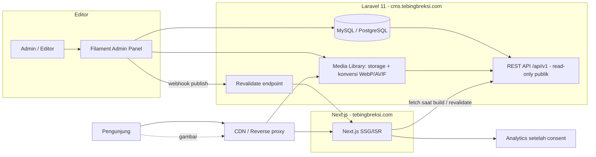
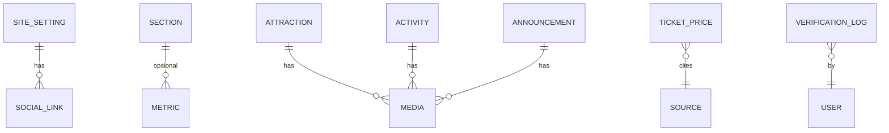

# 03 — Arsitektur Teknis

Headless CMS: **Laravel** (API + admin) dan **React (Next.js)** (frontend). Solo developer, vibe coding, anggaran hosting belum diketahui.

Prinsip: **sesederhana mungkin, paket paling umum, mudah dibantu AI, murah dijalankan.**

---

## 1. Diagram Arsitektur



**Alur singkat:** editor mengubah konten di Filament → Laravel menyimpan dan memanggil webhook ke Next.js → halaman terkait dibangun ulang (ISR on-demand) → pengunjung selalu mendapat halaman statis cepat.

---

## 2. Keputusan Teknologi

| Layer | Pilihan | Alasan | Alternatif |
|---|---|---|---|
| Backend | **Laravel 11** (PHP 8.2+) | Pilihan Anda; ekosistem matang | — |
| Admin panel | **Filament 3** | UI admin siap pakai, form dan tabel cepat dibuat, ramah editor non-teknis, sangat dikenal AI | Laravel Nova (berbayar) |
| Frontend | **Next.js 14/15 (App Router)** + React + TypeScript | SSG/ISR untuk SEO dan LCP; masih React | Vite SPA (SEO lemah; tidak disarankan) |
| Styling | **Tailwind CSS** dengan palet dikunci (lihat `02-desain-ui-ux.md` §2.6) | Token terkunci mencegah warna terlarang | CSS Modules |
| i18n frontend | `next-intl` | Routing `/id`, `/en`, dukungan SSG | `next-i18next` |
| i18n backend | `spatie/laravel-translatable` | Simpan terjemahan di kolom JSON per field | Tabel terjemahan terpisah |
| Media | `spatie/laravel-medialibrary` + plugin Filament | Konversi responsif, koleksi, kredit | — |
| DB | MySQL 8 (atau PostgreSQL) | Umum di hosting murah | SQLite hanya untuk dev |
| Cache | File/DB cache (MVP); Redis opsional | Lalu lintas rendah, halaman statis | Redis |
| Auth admin | Filament (session) + 2FA opsional | Cukup untuk MVP | — |
| Analytics | **GA4** setelah consent, atau Plausible/Umami (lebih ringan, tanpa cookie) | Tergantung izin pengelola | — |
| Peta | Tautan Google Maps (MVP) | Ringan, tanpa API key | Embed / Leaflet nanti |
| Monitoring | UptimeRobot + log Laravel + Sentry (gratis) | Murah | — |

**Rekomendasi default stack murah:** satu VPS kecil (1–2 vCPU, 2 GB RAM) untuk Laravel + MySQL, dan frontend Next.js di Vercel/Netlify/Cloudflare Pages **atau** VPS yang sama dengan Node. Karena anggaran belum diketahui, siapkan dua opsi (§11).

---

## 3. Struktur Repositori

Dua repo (atau monorepo sederhana), lebih mudah dipahami AI dan dideploy terpisah.

```
tebing-breksi/
├── backend/                       # Laravel
│   ├── app/
│   │   ├── Models/                # Attraction, Activity, Metric, TimelineEvent, TicketPrice, ...
│   │   ├── Filament/Resources/    # Resource admin per content type
│   │   ├── Http/Controllers/Api/  # HomeController, SettingsController, ...
│   │   ├── Http/Resources/        # API Resource (transformasi JSON)
│   │   ├── Observers/             # Trigger webhook revalidate + audit
│   │   ├── Policies/
│   │   └── Services/              # TicketVisibilityService, RevalidateService
│   ├── database/{migrations,seeders}/
│   ├── routes/api.php
│   └── tests/
├── frontend/                      # Next.js
│   ├── src/
│   │   ├── app/[locale]/          # page.tsx (home), informasi-kunjungan/, privasi/
│   │   ├── components/{ui,sections,layout}/
│   │   ├── lib/{api.ts,analytics.ts,format.ts}
│   │   ├── i18n/{routing.ts,messages/id.json,en.json}
│   │   └── styles/{tokens.css,globals.css}
│   ├── public/
│   ├── tailwind.config.ts
│   └── tests/ (playwright)
└── docs/                          # dokumen ini
```

---

## 4. Data Model

### 4.1 ERD



### 4.2 Tabel dan Field

Field bertanda 🌐 berupa JSON terjemahan `{ "id": "...", "en": "..." }` (spatie translatable).

**`site_settings`** (satu baris)
| Field | Tipe | Catatan |
|---|---|---|
| name 🌐 | json | Nama destinasi |
| tagline 🌐 | json | Deskripsi singkat footer |
| address 🌐 | json | |
| email, phone | string null | |
| whatsapp_number | string null | Format internasional tanpa `+`, misal `62812...` |
| whatsapp_message 🌐 | json | Pesan awal otomatis |
| maps_url, directions_url | string | Tautan Google Maps |
| latitude, longitude | decimal(10,7) | Diuji manual sebelum dipakai |
| social_links | json | `[{platform, url, label}]` |
| privacy_contact | string null | |

**`hero`** (satu baris aktif): eyebrow 🌐, headline 🌐, description 🌐, primary_cta_label 🌐, primary_cta_url, secondary_cta_label 🌐, secondary_cta_url, image (media), image_alt 🌐, focal_desktop `{x,y}`, focal_mobile `{x,y}`.

**`sections`**: key (`intro`, `closing_cta`, ...), eyebrow 🌐, title 🌐, body 🌐 (rich text), image, image_alt 🌐, cta_label 🌐, cta_url, order, is_visible.

**`metrics`**: value (string, mis. "20–36"), unit 🌐, label 🌐, context 🌐 null, source_title, source_url null, verified_at, order, status (`draft|published|archived`), highlight (bool).

**`attractions`**: slug, title 🌐, category (`heritage|panorama|venue|nature`), summary 🌐, body 🌐 null, cover_image, image_alt 🌐, gallery, is_featured, link_url null, order, status, verified_at null.

**`activities`**: slug, title 🌐, category (`jeep|camping|culture|culinary|venue|stay`), summary 🌐, detail 🌐 null, provider_name, contact_url null, booking_url null, availability_status (`active|inactive|seasonal|unverified`), cover_image null, image_alt 🌐, order, verified_at null, status.

**`timeline_events`**: period_label 🌐 (mis. "30 Mei 2015"), sort_date (date/year int), title 🌐, description 🌐, source_title, source_url null, order, status.

**`visit_info`** (satu baris): facilities (json list 🌐), safety_notes 🌐, accessibility_notes 🌐, parking_notes 🌐, verified_at, verified_by.

**`opening_hours`**: service_key (`general|jeep|camping|venue|cafe`), label 🌐, schedule (json: hari → buka/tutup, atau teks bebas 🌐), note 🌐, verified_at null, verified_by null, status (`verified|pending_confirmation|expired`).

**`ticket_prices`**
| Field | Tipe | Catatan |
|---|---|---|
| visitor_type | enum | `domestic|international|child|adult` |
| label 🌐 | json | "Wisatawan Nusantara (WNI)" |
| differentiate_weekend | bool | Saklar yang Anda minta (D-06) |
| weekday_price | int null | Rupiah |
| weekend_price | int null | |
| holiday_price | int null | |
| currency | string | `IDR` |
| effective_from, effective_until | date null | |
| source_url | string null | |
| source_note | string null | |
| verified_at | datetime null | |
| verified_by | string null | |
| status | enum | `verified|pending_confirmation|expired` |
| order | int | |

**`announcements`** *(P1)*: title 🌐, slug, summary 🌐, body 🌐, cover, published_at, status.

**`gallery_items`** *(P1)*: media, caption 🌐, alt 🌐, category, credit, license_note, consent_ref, status.

**`redirects`**: from_path, to_path, status_code (301). (dibaca saat build, lihat §9)

**`audit_logs`**: user_id, model, model_id, field, old, new, created_at (otomatis dari Observer untuk `ticket_prices`, `opening_hours`, `site_settings`, `activities`).

Semua tabel konten memakai `softDeletes`, `created_at`, `updated_at`, `updated_by`.

---

## 5. API (read-only, publik)

Base: `https://cms.tebingbreksi.com/api/v1`. Semua `GET`, mendukung `?locale=id|en`. Hanya mengembalikan konten `status=published`.

| Endpoint | Isi |
|---|---|
| `GET /home` | Satu respons gabungan untuk homepage: settings, hero, sections, metrics, attractions, activities, timeline, visit, tickets, hours (mengurangi jumlah request saat build) |
| `GET /settings` | Site settings |
| `GET /visit` | Visit info, ticket (sudah difilter), opening hours |
| `GET /attractions`, `GET /attractions/{slug}` | (detail untuk fase berikutnya) |
| `GET /activities` | |
| `GET /announcements` | (P1) |
| `GET /redirects` | Untuk pembangkitan redirect saat build |

**Contoh respons tarif (disaring di server):**

```json
{
  "tickets": {
    "state": "pending_confirmation",
    "message": { "id": "Konfirmasi tarif terbaru", "en": "Please confirm the latest fare" },
    "items": []
  }
}
```
```json
{
  "tickets": {
    "state": "verified",
    "differentiate_weekend": true,
    "verified_at": "2026-11-20T09:00:00+07:00",
    "items": [
      { "label": "WNI", "weekday": 10000, "weekend": 15000, "currency": "IDR" }
    ]
  }
}
```

**Aturan keamanan tarif ada di server, bukan hanya frontend:** `TicketVisibilityService` tidak pernah mengirim angka jika `status != verified` atau `effective_until < today`. Frontend tidak memegang harga yang belum terverifikasi sama sekali.

**Caching:** respons dibungkus `Cache::remember` (5 menit) dan dibersihkan oleh Observer saat konten berubah. Tambahkan header `Cache-Control: public, max-age=60, stale-while-revalidate=300` dan `ETag`.

**Rate limit:** `throttle:60,1` pada grup API publik.

**CORS:** izinkan hanya origin frontend produksi dan staging.

---

## 6. Alur Publikasi dan Revalidasi

1. Editor menyimpan konten di Filament.
2. `Observer` (created/updated/deleted) membersihkan cache API dan mengirim `POST https://tebingbreksi.com/api/revalidate` dengan header `x-revalidate-secret` dan body `{ "tags": ["home","visit"] }`.
3. Next.js memanggil `revalidateTag(...)`; halaman dibangun ulang pada permintaan berikutnya.
4. Cadangan: `revalidate = 3600` (ISR berkala) bila webhook gagal. Kegagalan webhook dicatat dan diulang (queue job, 3 percobaan).

Ini menjamin target "perubahan tampil ≤ 60 detik" dan tetap menyajikan halaman statis.

---

## 7. Internasionalisasi

- Routing: `/id` (default), `/en`. `/` mengarahkan ke `/id` (atau mendeteksi `Accept-Language`, lalu menyimpan cookie).
- UI string (tombol, label tetap): `messages/id.json` dan `en.json`.
- Konten dinamis: JSON terjemahan di DB; API menerima `locale` dan mengembalikan satu bahasa, dengan `fallback: id` + penanda `is_fallback: true`.
- Admin: field terjemahan berupa tab ID/EN (plugin `filament-spatie-laravel-translatable-plugin`), indikator "EN belum diisi".
- Format: tanggal `Intl.DateTimeFormat(locale)`, mata uang `Intl.NumberFormat(locale, {style:'currency', currency:'IDR', maximumFractionDigits:0})`.
- SEO: `<link rel="alternate" hreflang="id|en|x-default">` dan canonical per bahasa.

---

## 8. SEO Teknis

- Metadata per halaman lewat `generateMetadata` (title ≤ 60 karakter, description ≤ 155).
- Open Graph + Twitter card, gambar 1200×630.
- `sitemap.xml` dan `robots.txt` dibangkitkan Next.js; sitemap menyertakan alternatif bahasa.
- Structured data JSON-LD: `TouristAttraction` hanya jika data (alamat, geo, jam) sudah terverifikasi dan disetujui (PRD §14.3).
- Satu `<h1>`; heading berurutan; `<html lang>`.
- URL bersih, canonical absolut.
- Pengalihan dari website lama (§9).

---

## 9. Redirect dari Website Lama

1. Ambil daftar URL lama (`/sitemap.xml` website lama, atau crawl) sebelum domain dialihkan.
2. Isi tabel `redirects` (atau `next.config.js` `redirects()` yang dibangkitkan dari API saat build).
3. Contoh peta awal (sesuaikan setelah inventaris):

| Lama | Baru |
|---|---|
| `/profil/` | `/id#tentang` |
| `/wisata/` | `/id#aktivitas` |
| `/keunikan/` | `/id#daya-tarik` |
| `/formulir-reservasi/` | `/id/informasi-kunjungan` |
| `/2024/11/28/penyesuaian-harga-...` | `/id/informasi-kunjungan` |
| `/2022/01/19/panggung-terbuka-tlatar-seneng-...` | `/id#daya-tarik` |

Fragment (`#`) tidak diteruskan oleh redirect HTTP di sisi server, jadi gunakan halaman tujuan nyata (misalnya `/id/informasi-kunjungan`) untuk redirect penting, dan anchor hanya sebagai tujuan akhir yang dapat dibuka ulang oleh client. Uji setiap redirect di staging.

---

## 10. Keamanan dan Privasi

- HTTPS wajib, HSTS aktif.
- Admin Filament: URL tidak umum (`/panel`), password kuat, opsional 2FA, batasi percobaan login, akun terpisah per editor.
- Peran dan kebijakan (`admin`, `editor`); tarif/kontak/jam hanya diubah `admin` atau `verifier`.
- **Pemisahan login (belum diputuskan), lihat §10.1.**
- Validasi input di server (Form Request / aturan Filament). Rich text disanitasi (`HTMLPurifier`).
- Upload gambar: batasi MIME (jpg, png, webp, avif), ukuran ≤ 10 MB, proses ulang lewat konversi (hapus metadata EXIF lokasi dari foto pengguna).
- Secret (`REVALIDATE_SECRET`, DB) hanya di `.env`, tidak di repo.
- Header keamanan: `Content-Security-Policy`, `X-Content-Type-Options`, `Referrer-Policy`, `Permissions-Policy`.
- Tidak ada form publik di MVP, jadi tidak ada data pribadi yang disimpan.
- Analytics hanya setelah consent; IP dianonimkan (GA4 default) atau pakai analytics tanpa cookie.
- **Guard produksi:** skrip build frontend memeriksa data wajib (nomor WhatsApp, maps_url, alamat, hero image). Jika kosong atau berisi placeholder, `next build` **gagal** di lingkungan produksi. Ini menegakkan "tidak ada tautan placeholder".
- Backup DB harian (retensi 7–14 hari) + backup `storage/` mingguan.

### 10.1 Opsi pemisahan login admin dan editor

| | Opsi 1: satu panel + peran | Opsi 2: dua panel (`/panel`, `/editor`) |
|---|---|---|
| Cara | Satu login, menu dan izin dibatasi lewat peran (mis. Filament Shield) | Dua panel Filament, resource ditaruh di folder terpisah; `canAccessPanel()` memeriksa kolom `role` |
| Kelebihan | Paling sederhana | Editor tidak punya menu sensitif sama sekali; login terpisah |
| Kekurangan | Menu perlu disembunyikan lewat izin | Konfigurasi lebih banyak (±3–4 jam tambahan di S1-11) |

Apa pun opsinya: **wajib Policy** pada `TicketPrice`, `OpeningHour`, `SiteSetting` agar editor ditolak walau mengakses URL langsung. Untuk tim kecil, gunakan satu tabel `users` dengan kolom `role`, bukan guard terpisah.

**Kontak WhatsApp:** `site_settings.whatsapp_number` satu nomor. Jika pengelola memisahkan nomor per kategori (umum, venue/event, camping/jeep), ganti dengan field `contacts` (json: `[{category, number, message}]`).

---

## 11. Deployment (siapkan dua opsi karena anggaran belum diketahui)

### Opsi A — Hemat (disarankan awal)
- Backend: hosting PHP 8.2+ dengan SSH/Composer atau VPS kecil.
- Frontend: Vercel/Netlify/Cloudflare Pages tier gratis (cek batas dan kebijakan penggunaan komersial sebelum memutuskan).
- Domain: `tebingbreksi.com` → frontend; `cms.tebingbreksi.com` → backend.

### Opsi B — Satu VPS
- Nginx, PHP-FPM, MySQL, Node (PM2) untuk Next.js, Certbot (HTTPS), Cloudflare gratis di depan untuk CDN dan caching.

### Lingkungan
| Env | Domain | Tujuan |
|---|---|---|
| local | localhost | Pengembangan |
| staging | `staging.` / `cms-staging.` | Demo ke pembimbing, UAT |
| production | domain utama | Publik |

### CI/CD sederhana (GitHub Actions)
- Backend: `composer install` → `php artisan test` → deploy (rsync/SSH) → `php artisan migrate --force`.
- Frontend: `pnpm install` → `pnpm lint` → `pnpm build` → deploy.
- Lighthouse CI + axe di pull request ke `main` (lihat `05-qa-dan-acceptance.md`).

### Hari peluncuran (cutover)
1. Turunkan TTL DNS 24 jam sebelumnya.
2. Pastikan redirect lama berfungsi di staging.
3. Alihkan DNS, verifikasi HTTPS, uji ulang redirect dan sitemap.
4. Daftarkan sitemap baru di Google Search Console.
5. Pantau error 404 pertama dua minggu.
6. Simpan cadangan website lama (ekspor konten) sebelum dimatikan.

---

## 12. Rencana Environment Variables

**Backend `.env`**
```
APP_URL=https://cms.tebingbreksi.com
FRONTEND_URL=https://tebingbreksi.com
REVALIDATE_URL=https://tebingbreksi.com/api/revalidate
REVALIDATE_SECRET=...
DB_*=...
FILESYSTEM_DISK=public
```
**Frontend `.env`**
```
NEXT_PUBLIC_SITE_URL=https://tebingbreksi.com
API_BASE_URL=https://cms.tebingbreksi.com/api/v1
REVALIDATE_SECRET=...
NEXT_PUBLIC_GA_ID=...        # hanya setelah consent
```

---

## 13. Panduan Vibe Coding untuk Stack Ini

- **Urutan:** migrasi + model → seeder → Filament Resource → API Resource → komponen UI → section → i18n → SEO.
- Minta AI menulis **tes untuk `TicketVisibilityService`** terlebih dahulu; ini aturan bisnis paling penting.
- Setiap sesi: sertakan aturan non-negosiasi dari `00-README.md` §6.
- Jangan biarkan AI menambah library baru tanpa alasan; tolak dependensi besar (carousel, animasi berat).
- Review manual: query N+1, field yang bocor di API, `dangerouslySetInnerHTML` tanpa sanitasi, warna di luar token.
- Commit kecil per fitur, branch per sprint ticket, tag rilis (`v0.1.0` demo, `v1.0.0` launch).

---

## 14. Risiko Teknis

| Risiko | Dampak | Mitigasi |
|---|---|---|
| Webhook revalidate gagal | Konten lama tampil | ISR berkala + queue retry + tombol "Rebuild" di admin |
| Hosting tidak mendukung Node/Composer | Deploy terhambat | Opsi A (frontend di platform static/edge) |
| Gambar besar memperlambat | LCP buruk | Konversi otomatis WebP/AVIF, `srcset`, batas upload |
| AI memasukkan warna di luar palet | Pelanggaran PRD | Tailwind palet terkunci + audit warna otomatis |
| Terjemahan EN tidak lengkap | UX tidak konsisten | Indikator di admin + fallback bertanda |
| Satu orang sakit/ujian | Jadwal mundur | Buffer 15–20% di sprint plan |
